<h1 align="center">Hi, I'm Amegh 👋</h1>

  <b>Full-stack developer in Kerala, India</b> 
  I build products end-to-end, from database to interface.

  <a href="https://amegh.me">Portfolio</a> ·
  <a href="https://www.linkedin.com/in/amegh-ts/">LinkedIn</a> ·
  <a href="https://www.behance.net/ameghts">Behance</a> ·
  <a href="mailto:hey@amegh.me">hey@amegh.me</a>

## About

Three years shipping booking, payment and admin systems with Next.js and Node.js.

- 💼 Software Developer at **Oppam**, an online counselling platform. I work on payments (Stripe, Razorpay), pricing, HR tools, role-based permissions and the admin panel.
- 🧭 Previously built the **Club Travalet** travel booking portal, with SEO and server-side rendering.
- 🧪 I care about getting money, time and data right, and I back it with Vitest and Playwright tests.
- 📫 Open to full-stack roles and interesting projects: **hey@amegh.me**

## Stack

  
  
  
  
  
  
  
  
  
  
  
  
  
  
  
  
  

## Featured projects

| Project | What it is | Built with |
| --- | --- | --- |
| [**Finance App**](https://github.com/TVRCloud/expense-tracker) | Expense tracker for web with an Android companion. Bank SMS messages are auto-imported into transactions through an n8n workflow, with live balances and budget alerts. | Next.js 15, Flutter, Kotlin, Socket.IO, MongoDB, Redis, PWA |
| [**UniTide**](https://github.com/TVRCloud/unitide) · [live demo](https://teamsync-one.vercel.app) | Task management and team collaboration: projects, tasks, teams, clients and comments, with admin and user roles. | Next.js 16, shadcn/ui, TanStack Query, MongoDB |
| [**amegh.me**](https://github.com/amegh-ts/amegh.me) | My portfolio, with selected work, experience and contact. | TypeScript, Next.js |

More of my work, including Oppam and Club Travalet, is on [amegh.me](https://amegh.me).

<picture>
  <source media="(prefers-color-scheme: dark)" srcset="https://raw.githubusercontent.com/amegh-ts/amegh-ts/output/pacman-contribution-graph-dark.svg">
  <source media="(prefers-color-scheme: light)" srcset="https://raw.githubusercontent.com/amegh-ts/amegh-ts/output/pacman-contribution-graph.svg">
  
</picture>
